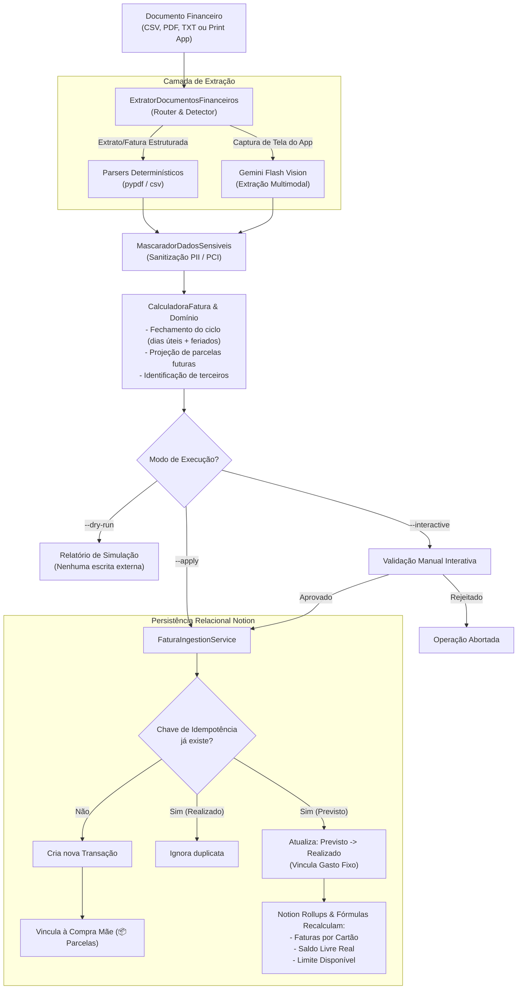
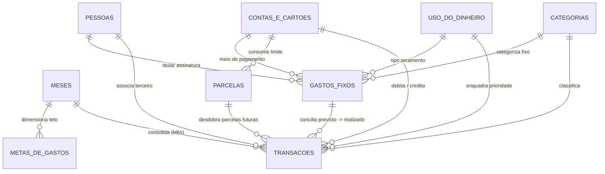
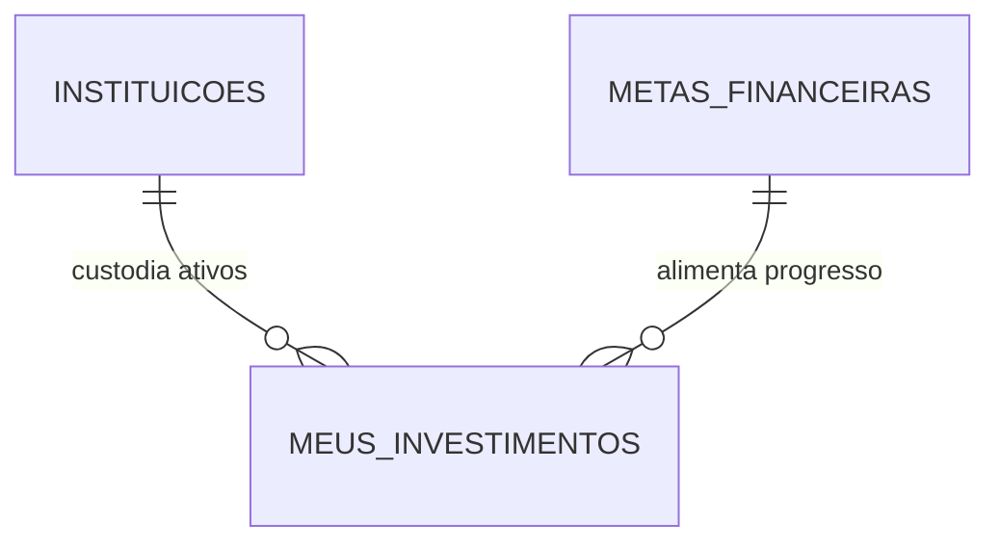

# 💼 Financial Control & Notion Integration Engine

[](https://www.python.org/)
[](#arquitetura-de-software)
[](https://developers.notion.com/)
[](tests/)

Motor de automação financeira ponta a ponta desenvolvido em **Python**, integrando **parsers determinísticos**, **visão computacional via LLM (Google Gemini Flash)** e a **API REST do Notion**.

O sistema orquestra a leitura de extratos bancários (`.csv`, `.pdf`), faturas de cartão de crédito e capturas de tela parciais de aplicativos de bancos, calculando ciclos de faturamento com respeito a feriados nacionais e dias úteis, projetando parcelamentos futuros e consolidando o fluxo de caixa com **idempotência estrita** e **precisão monetária decimal**.

---

## 📌 Sumário

1. [Visão Geral & Problema](#-visão-geral--problema)
2. [Arquitetura de Software](#-arquitetura-de-software)
3. [Fluxo de Execução da Ingestão](#-fluxo-de-execução-da-ingestão)
4. [Engenharia de Dados & Schema DBML](#-engenharia-de-dados--schema-dbml)
5. [Estratégias de Parsing & Multi-Banco](#-estratégias-de-parsing--multi-banco)
6. [Regras de Domínio Financeiro & Orçamento](#-regras-de-domínio-financeiro--orçamento)
7. [Guia de Customização Manual (Notion & Código)](#-guia-de-customização-manual-notion--código)
8. [Segurança & Sanitização (PII)](#-segurança--sanitização-pii)
9. [Como Executar](#-como-executar)
10. [Suíte de Testes Automatizados](#-suíte-de-testes-automatizados)

---

## 🎯 Visão Geral & Problema

O acompanhamento de finanças pessoais frequentemente sofre de três atritos estruturais:

1. **Descompasso entre data da compra e ciclo da fatura:** Uma compra realizada no final de um mês calendário pode pertencer à competência financeira seguinte dependendo da regra de corte do emissor (dias úteis antes do vencimento).
2. **Compras parceladas e comprometimento de limite:** Aplicativos bancários não projetam nativamente os meses futuros em uma visão orçamentária unificada.
3. **Descasamento de fluxo de caixa:** Atraso entre o pagamento de faturas e o reembolso de despesas compartilhadas ou empréstimos com terceiros.

Este projeto resolve esses desafios desacoplando a **captura de dados** da **apresentação**, delegando ao Python o processamento matemático determinístico e utilizando o Notion como data warehouse relacional e frontend analítico.

---

## 🏗️ Arquitetura de Software

O ecossistema é baseado nos princípios de **Clean Architecture** e **DDD Lite**, garantindo que as regras de negócio financeiras independam de frameworks externos, bibliotecas de terceiros ou da própria API do Notion:

```text
Controle-Financeiro/
├── financas/
│   ├── config.py             # Configurações globais e dataclasses imutáveis (AppConfig, CartaoConfig)
│   ├── domain/               # Camada Core de Negócio (Isolada, pura e determinística)
│   │   ├── models.py         # Entidades de domínio (LancamentoTransacao, GastoFixo, Decimal estrito)
│   │   ├── billing.py        # CalculadoraFatura (regras de corte, dias úteis, projeção de parcelas)
│   │   └── classification.py # ClassificadorCategoria e motor de conciliação
│   ├── parsers/              # Adaptadores de Extração de Documentos
│   │   ├── base.py           # BasePdfParser e contratos de interface
│   │   ├── sanitization.py   # MascaradorDadosSensiveis (PCI-DSS & LGPD compliance: cartões, CPF, contas)
│   │   ├── inter.py          # Extrator determinístico para faturas em PDF
│   │   ├── bradesco.py       # Extratores para extratos de conta corrente e faturas de cartão
│   │   ├── santander.py      # Extrator CSV, PDF e extrator multimodal via Gemini Flash Vision
│   │   └── router.py         # ExtratorDocumentosFinanceiros (auto-detecção de formato e emissor)
│   ├── notion/               # Adaptadores de Infraestrutura (Notion API REST)
│   │   ├── client.py         # NotionClient resiliente (HTTP Session, backoff exponencial, rate-limiter)
│   │   ├── builders.py       # NotionPropertyBuilder e Serializers de payload
│   │   └── repositories/     # Data Access Layer modular (Transações, Meses, Gastos Fixos, Pessoas, Catálogo)
│   └── services/             # Camada de Aplicação / Casos de Uso
│       ├── ingestion.py      # FaturaIngestionService (pipeline de ingestão, dry-run e conciliação)
│       ├── fixed_expenses.py # GastosFixosService (provisionamento mensal de custos recorrentes)
│       └── setup.py          # WorkspaceSetupService (migrações e infraestrutura idempotente)
├── tests/                    # Suíte completa de testes unitários determinísticos
├── ingest_fatura.py          # CLI de ingestão operacional (--apply, --dry-run, --interactive)
├── lancar_fixos.py           # CLI de previsão e conciliação de custos fixos
└── schema.dbml               # Especificação formal do banco de dados relacional
```

---

## 🔄 Fluxo de Execução da Ingestão

O pipeline garante integridade transacional e idempotência estrita (reprocessar o mesmo extrato ou print 10 vezes gera exatamente o mesmo estado final no Notion, sem duplicidade):



---

## 📊 Engenharia de Dados & Schema DBML

O workspace no Notion foi modelado como um banco de dados relacional em terceira forma normal (3NF), mapeando transações diárias a agregadores analíticos mensais.

O schema completo está documentado em [`schema.dbml`](schema.dbml). A arquitetura visual divide-se em dois módulos funcionais estritamente segregados:

### 1. Módulo Operacional & Fluxo de Caixa Diário

Rastreia entradas, saídas, faturas, fixos, parcelamentos e compensação de terceiros:



### 2. Módulo de Patrimônio & Investimentos (Isolado)

Opera desacoplado das despesas operacionais do dia a dia, mantendo o controle patrimonial, rentabilidade e metas de longo prazo:



> [!NOTE]
> As bases de **Patrimônio & Investimentos** não se misturam com as despesas correntes de cartão/conta, preservando a liquidez e garantindo que o dinheiro guardado não seja computado como gasto operacional.

### Principais Entidades

* **`Transações`**: Hub transacional central. Armazena data da compra, data de criação nativa (`created_time`), valor monetário, status (`Previsto` / `Realizado`), vínculos relacionais e chave de idempotência.
* **`Meses`**: Agregador mensal analítico. Consolida totais por fórmulas dinâmicas (`Receita`, `Bônus`, `Meus Gastos`, `Gastos Terceiros`, `Saldo Livre Real`, `Comprometido`, `Faturas por Emissor`).
* **`Contas, cartões e reservas`**: Gestão de liquidez e passivos. Rastreia saldos bancários, limites totais de crédito contratados, limites disponíveis e totais comprometidos.
* **`🎯 Metas de Gastos & Orçamento`**: Base de planejamento macro (Gastos Fixos, Livre para Gastar e Investimentos) com cálculo dinâmico de orçamento permitido e progresso.
* **`📦 Parcelas`**: Acompanhamento de compras a prazo. Monitora ciclo atual, total de parcelas, progresso percentual ponderado e liberação gradual de limite.
* **`Gastos Fixos`**: Registro de compromissos recorrentes mensais e assinaturas com conciliação automática (`Previsto` $\rightarrow$ `Realizado`).
* **`Pessoas`**: Conta-corrente relacional interna para rastreio de valores compartilhados com terceiros e liquidação via Pix.
* **`Meus Investimentos` & `Instituições`**: Consolidação patrimonial de ativos, acompanhando preço de aquisição, valor de mercado atualizado e rendimento líquido (R$ e %).
* **`Metas Financeiras`**: Objetivos de médio/longo prazo (reserva de emergência, aquisições) alimentados pelo portfólio de ativos.

---

## 🔍 Estratégias de Parsing & Multi-Banco

| Fonte | Formato | Estratégia de Engenharia |
|---|---|---|
| **Extrato Conta Corrente** | `.csv` | Parser determinístico de streaming com normalização de pontuação brasileira, identificação de proventos e categorização de transferências internas. |
| **Fatura de Cartão Fechada** | `.pdf` | Parser vetorial via `pypdf`, isolando metadados de cabeçalho (data de corte, vencimento) e tabelas transacionais de despesas e parcelamentos. |
| **Fatura Aberta / Parcial** | Imagem (`.png`, `.jpg`) / Texto | Extração multimodal estruturada com **Google Gemini Flash Vision**, guiada por JSON Schema estrito com conversão para entidades tipadas de domínio. |

---

## ⚖️ Regras de Domínio Financeiro & Orçamento

### 1. Cálculo de Competência por Corte
As faturas fecham $N$ dias corridos ou úteis antes do vencimento. A data de corte efetiva ($D_c$) determina o mês de faturamento:
* Compras realizadas antes de $D_c$ pertencem ao mês do ciclo atual.
* Compras realizadas a partir de $D_c$ entram na competência seguinte.
* Para dias úteis, o cálculo retrocede fins de semana e feriados bancários nacionais através da biblioteca `holidays` (Brasil).

### 2. Aritmética de Ponto Fixo (Decimal)
Para prevenir erros cumulativos de ponto flutuante IEEE 754 típicos em operações com `float`:
$$\text{Todas as quantias monetárias são estritamente representadas por } \texttt{decimal.Decimal}$$

### 3. Fórmulas de Fluxo de Caixa Dinâmico & Bônus
O sistema calcula o saldo disponível antes mesmo da entrada efetiva dos proventos mensais no dia 25, incorporando proventos extras (13º, PLR, férias) quando preenchidos na coluna `Bônus`:

$$\text{Renda Total} = \max(\text{Receita Real}, \text{Salário Base}) + \text{Bônus}$$

$$\text{Saldo Livre Real} = \text{Renda Total} - \text{Meus Gastos}$$

$$\text{Saldo Caixa Previsto (Dia 25)} = \text{Renda Total} - (\text{Meus Gastos} + \text{Gastos Terceiros})$$

### 4. Orçamento Percentual & Teto de Gastos Mensal
A meta orçamentária é parametrizada em três blocos estratégicos personalizáveis:
* **Gastos Fixos + Parcelas (~50%):** Compromissos estruturais recorrentes (moradia, condomínio, contas de consumo, internet, assinaturas e parcelamentos).
* **Livre para Gastar (~25%):** Despesas variáveis e discricionárias do cotidiano (lazer, alimentação fora, transporte privado e compras avulsas).
* **Investimento (~24%):** Aportes patrimoniais protegidos para reserva e metas financeiras de longo prazo.

A barra de progresso visual de cada mês (`Comprometido`) acompanha estritamente o teto de gastos do mês, protegendo a parcela reservada para investimentos:

$$\text{Meta Mensal} = \text{Meta Fixos} + \text{Meta Livre}$$

$$\text{Comprometido (\%)} = \frac{\text{Meus Gastos}}{\text{Meta Mensal}}$$

---

## 🛠️ Guia de Customização Manual (Notion & Código)

Este tópico orienta você sobre **onde e como alterar** qualquer informação financeira sem risco de quebrar o sistema.

### 📌 1. O que você pode alterar diretamente no Notion (Sem mexer em código)

| O que você quer alterar? | Onde alterar no Notion | O que acontece |
|---|---|---|
| **Salário Base** | Tabela `Meses` $\rightarrow$ Coluna `Salário Base` | Altera o salário do mês. Todas as fórmulas de saldo livre, caixa do dia 25 e metas recalculam instantaneamente. |
| **Bônus / 13º / PLR / Férias** | Tabela `Meses` $\rightarrow$ Coluna `Bônus` | Preencha o valor extra recebido no mês. O card exibirá `💵 Salário + Bônus` e o caixa previsto aumentará. |
| **Metas de Orçamento (% e R$)** | Página `Gastos Fixos` $\rightarrow$ Tabela `🎯 Metas de Gastos & Orçamento` e na base `Meses` | Na tabela de Gastos Fixos, altere a `% de gastos`; o valor em R$ recalcula por fórmula. Na tabela `Meses`, ajuste `Meta Fixos`, `Meta Livre` ou `Meta Investimento` para personalizar meses atípicos. |
| **Meio de Pagamento dos Fixos** | Tabela `Gastos Fixos` $\rightarrow$ Coluna `Pago com` | Altere a conta ou cartão vinculado (ex: mudar de `Inter Credito` para `Santander Credito` ou `Santander Conta`). O script `lancar_fixos.py` lê essa relação dinamicamente. |
| **Valor ou Dia do Gasto Fixo** | Tabela `Gastos Fixos` $\rightarrow$ Colunas `Valor cobrado`, `Valor meu` ou `Dia da cobrança` | Ajusta o valor e a data calculada para o pré-lançamento do mês seguinte. |
| **Novo Gasto Fixo / Assinatura** | Tabela `Gastos Fixos` $\rightarrow$ Botão `+ Nova` | Preencha Nome, Valor, `Pago com`, Categoria e `Nome na fatura` (como aparece na fatura para conciliação automática). Marque `Ativo = Sim`. |
| **Nova Categoria** | Tabela `Categorias` $\rightarrow$ Botão `+ Nova` | Crie a categoria com o emoji desejado. Ela fica disponível imediatamente para seleção nas transações e fixos. |
| **Pessoas / Terceiros** | Tabela `Pessoas` $\rightarrow$ Adicionar ou editar | Adicione novos contatos e seus apelidos de Pix/Fatura em `Nome no Pix / Fatura` (separados por ponto e vírgula). |
| **Regras dos Cartões (Corte/Vencimento)** | Tabela `Contas, cartões e reservas` $\rightarrow$ Colunas `Dia de vencimento`, `Dias de fechamento`, `Regra de corte` | O motor de ingestão prioriza as configurações da tabela do Notion para calcular o fechamento da fatura. |

### 💻 2. O que você pode alterar nos Arquivos de Configuração Local

Caso queira ajustar palavras-chave ou regras determinísticas no código:

* **Palavras-chave de Categorias (`regras_categoria.json`):**
  Mapeamento de termos que aparecem na fatura para a categoria do Notion. Exemplo:
  ```json
  "uber": "Transporte Privado",
  "99app": "Transporte Privado",
  "ifood": "Lanche",
  "padaria": "Alimentação",
  "luz": "Luz",
  "condominio": "Condominio",
  "aluguel": "Aluguel",
  "correios": "Internet"
  ```
  Se você fizer compras frequentes em uma loja específica, basta adicionar `"nome da loja": "Nome da Categoria"` neste arquivo.

* **Regras de Compras de Terceiros (`regras_terceiros.json`):**
  Permite identificar compras parceladas que pertencem a amigos/familiares mesmo que a descrição não cite o nome da pessoa:
  ```json
  [
    {
      "padrao_descricao": "ASSINATURA AMIGO",
      "pessoa": "Nome da Pessoa",
      "valor_a_receber": 50.00,
      "categoria": "Emprestimo cartão"
    }
  ]
  ```

* **Credenciais e Chaves (`.env`):**
  Atualize o `NOTION_TOKEN` (caso gere uma nova integração) ou a `GEMINI_API_KEY` (para a visão computacional de prints).

* **Regras Padrão de Cartões (`financas/config.py`):**
  Contém as regras de fallback caso o Notion esteja indisponível (`DEFAULT_CARTOES`), definindo dia de vencimento e regra de corte (`DIAS_UTEIS` ou `DIAS_CORRIDOS`).

---

## 🔒 Segurança & Sanitização (PII)

O código foi projetado observando padrões de conformidade com **LGPD** e **PCI-DSS**:

* **Mascaração de PII:** Funções dedicadas mascaram números de cartão de crédito (`XXXX-XXXX-XXXX-1234`), CPF (`***.XXX.XXX-**`), agências bancárias e contas correntes nos logs e visualizações.
* **Isolamento de Credenciais:** Tokens do Notion e chaves de API são consumidos exclusivamente via variáveis de ambiente (`.env`), com `repr=False` nas dataclasses correspondentes para impedir vazamentos acidentais em stacktraces.
* **Zero Storage de Faturas:** Arquivos brutos de extratos são mantidos exclusivamente em diretórios locais ignorados pelo controle de versão (`.gitignore`).

---

## 🚀 Como Executar

### Pré-requisitos
* Python 3.11 ou superior
* Virtualenv configurado

### 1. Instalação

```bash
# Clonar o repositório
git clone https://github.com/seu-usuario/controle-financeiro.git
cd controle-financeiro/Controle-Financeiro

# Criar e ativar o ambiente virtual
python -m venv .venv
source .venv/bin/activate  # No Windows: .venv\Scripts\activate

# Instalar dependências
pip install -r requirements.txt
```

### 2. Variáveis de Ambiente
Crie um arquivo `.env` na raiz do módulo `Controle-Financeiro/`:

```env
NOTION_TOKEN=secret_seu_token_notion_aqui
GEMINI_API_KEY=sua_chave_gemini_opcional_aqui
```

### 3. Operação via CLI

```bash
# 1. Provisionar Gastos Fixos como "Previstos" no início do mês
python -m financas.cli fixos 2026-Novembro --dry-run      # Simular sem persistir
python -m financas.cli fixos 2026-Novembro --interactive  # Confirmar antes de enviar
python -m financas.cli fixos 2026-Novembro                # Execução direta

# 2. Ingerir Faturas e Extratos (Auto-detecta arquivos na pasta faturas/)
python -m financas.cli ingest --dry-run                   # Auditoria e simulação
python -m financas.cli ingest --interactive               # Revisão interativa
python -m financas.cli ingest                             # Ingestão e conciliação

# 3. Atualizar Cotações e Fechamento Mensal de Investimentos
python -m financas.cli investimentos --cotacao --dry-run
python -m financas.cli investimentos --fechar-mes --dry-run
```

---

## 🧪 Suíte de Testes Automatizados

O projeto conta com cobertura extensiva de testes de unidade para todas as regras de domínio, cálculos de fechamento, conciliação e mascaramento de dados:

```bash
python -m unittest discover -s tests -v
```

Exemplo de execução da suíte:
```text
test_competencia_bradesco_mes_fechamento ... ok
test_competencia_santander_pula_feriado ... ok
test_fechamento_inter_dias_corridos ... ok
test_projecao_parcelas_futuras ... ok
test_chave_idempotencia_normaliza_espacos ... ok
test_para_decimal_rejeita_float ... ok
test_mascarador_oculta_cartao_e_cpf ... ok
test_ingestion_service_dry_run_e_conciliacao ... ok
test_classificacao_transporte_privado ... ok
test_classificacao_contas_fixas_e_celular ... ok

----------------------------------------------------------------------
Ran 35 tests in 1.150s - OK
```

---

## 📄 Licença

Distribuído sob a licença **MIT**. Consulte `LICENSE` para mais informações.
