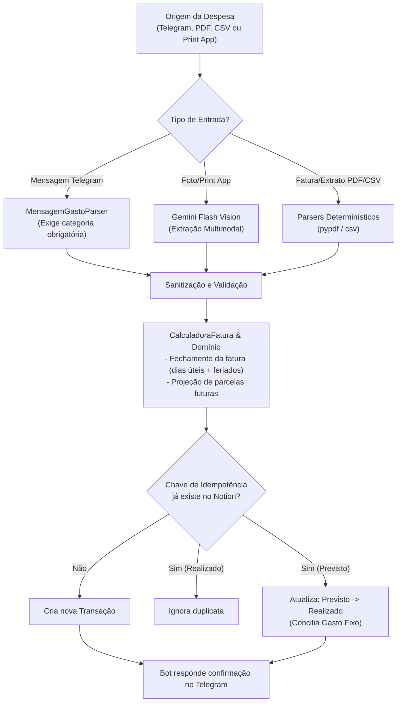
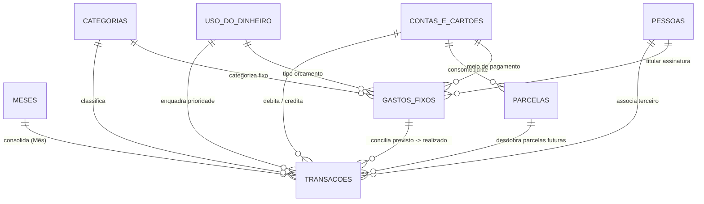

# 💼 Financial Control & Notion Integration Engine

[](https://www.python.org/)
[](https://core.telegram.org/bots)
[](.github/workflows/)
[](#arquitetura-de-software)
[](https://developers.notion.com/)
[](tests/)

Motor de automação financeira ponta a ponta desenvolvido em **Python**, integrando **bot assistente no Telegram**, **parsers determinísticos**, **visão computacional multimodal via LLM (Google Gemini Flash)** e a **API REST do Notion**, com rotinas automáticas gratuitas no **GitHub Actions**.

O sistema orquestra desde o registro de despesas rápidas via mensagem no Telegram (com validação estrita de categoria), leitura de faturas e extratos (`.csv`, `.pdf`, prints), projeção de compras parceladas, conciliação de gastos fixos com confirmação interativa, até a atualização semanal de cotações de investimentos (B3 e Tesouro Direto).

---

## 📌 Sumário

1. [Visão Geral & Diferenciais](#-visão-geral--diferenciais)
2. [🤖 Assistente Telegram & Lançamentos Rápidos](#-assistente-telegram--lançamentos-rápidos)
3. [⚡ Automações Serverless (GitHub Actions)](#-automações-serverless-github-actions)
4. [🏗️ Arquitetura de Software](#-arquitetura-de-software)
5. [🔄 Fluxo de Execução da Ingestão & Conciliação](#-fluxo-de-execução-da-ingestão--conciliação)
6. [📊 Engenharia de Dados & Schema Relacional (Notion)](#-engenharia-de-dados--schema-relacional-notion)
7. [⚙️ Regras de Configuração JSON (Locais vs GitHub Actions)](#-regras-de-configuração-json-locais-vs-github-actions)
8. [⚖️ Regras de Domínio Financeiro & Competência de Faturas](#-regras-de-domínio-financeiro--competência-de-faturas)
9. [🔒 Segurança & Sanitização (PII)](#-segurança--sanitização-pii)
10. [🚀 Como Executar Localmente](#-como-executar-localmente)
11. [🧪 Suíte de Testes Automatizados](#-suíte-de-testes-automatizados)

---

## 🎯 Visão Geral & Diferenciais

* **📱 Registro Rápido no Telegram com Categoria Obrigatória:** Envie `15 cafezinho lanche` ou `uber 20 transporte inter` no chat e a transação é computada e vinculada no Notion instantaneamente. Se a categoria for esquecida, o bot avisa e lista as opções válidas.
* **🔔 Lembrete Interativo de Gastos Fixos:** No dia previsto para uma despesa recorrente (ex: Aluguel ou Internet), o bot pergunta se o valor caiu certinho e oferece um botão inline `[✅ Confirmar]` para transformar `Previsto` em `Realizado`.
* **☁️ 100% Serverless & Gratuito no GitHub Actions:** Não requer servidores 24/7 ligados nem clusters pagos (como Airflow/MWAA). Os agendamentos do GitHub Actions cuidam de sincronizar o Telegram, atualizar investimentos e lançar o novo mês.
* **🧾 Extração Multimodal com IA:** Suporta PDFs estruturados, CSVs e capturas de tela parciais de faturas de cartões usando **Google Gemini Flash Vision** e parsing determinístico com `pypdf`.
* **📈 Portfólio de Investimentos:** Acompanha ativos de Renda Fixa (Tesouro Direto) e Renda Variável (B3) com cotações automáticas e snapshots mensais de patrimônio e rentabilidade.

---

## 🤖 Assistente Telegram & Lançamentos Rápidos

O bot (`@gastos_elobot`) é seu canal direto para registrar gastos diários sem precisar abrir o Notion:

### 1. Lançamento Manual de Despesas (Sem Adivinhação)
Para garantir que o nome do item nunca seja alterado, o bot aceita **2 formatos estruturados** (totalmente tolerantes à falta de acentos e maiúsculas/minúsculas):

#### Opção A: Atalho Rápido de 1 Linha (separado por `;`)
Formato: `Item ; Valor ; Categoria [; Conta] [; Uso]`

| Mensagem | Item | Valor | Categoria | Conta / Cartão | Uso |
| :--- | :--- | :--- | :--- | :--- | :--- |
| `filtro de cafe ; 20 ; casa` | filtro de cafe | R$ 20,00 | Casa | *Santader Credito (padrão)* | *Nao essencial (padrão)* |
| `almoco ; 35,90 ; alimentacao ; debito` | almoco | R$ 35,90 | Alimentação | Santader Conta | *Nao essencial* |
| `uber ; 22,50 ; transporte ; inter` | uber | R$ 22,50 | Transporte Privado | Inter Credito | *Nao essencial* |
| `remedio ; 45,90 ; saude ; debito ; essencial` | remedio | R$ 45,90 | Saúde | Santader Conta | Essencial |

#### Opção B: Modelo Copiar & Colar (`/modelo`)
```text
Item: filtro de café
Valor: 20
Categoria: casa
Conta: santander credito
```

> [!IMPORTANT]
> **Regras Pré-Acordadas:**  
> 1. **Categoria Obrigatória:** Se a categoria não for informada ou não existir, o bot avisa e orienta a consultar `/categorias`.  
> 2. **Padrão `Nao essencial`:** Todos os gastos avulsos entram por padrão como `Nao essencial` (já que os essenciais estão nos Gastos Fixos). Para forçar essencial, basta adicionar `; essencial` ou `Uso: essencial`.  
> 3. **Botão `[🗑️ Desfazer / Excluir]`:** Toda confirmação de gasto traz um botão inline para apagar o registro do Notion com 1 toque caso tenha digitado algo errado.

### 2. Leitura de Faturas e Comprovantes
* Envie fotos, prints de tela de aplicativos de bancos ou arquivos PDF de faturas diretamente no chat.
* O bot baixa o arquivo temporariamente, executa a extração inteligente e grava no Notion com conciliação automática.

### 3. Confirmação de Gastos Fixos Previstos
* No dia do vencimento de um custo fixo (ex: dia 07), o bot envia uma notificação:
  > 🔔 **Lembrete de Gasto Fixo Previsto Hoje:**  
  > • **Item:** Aluguel  
  > • **Valor:** R$ 1.200,00  
  > • **Meio de Pagamento:** Santander Conta  
  > *Esse valor caiu certinho na conta?*
* Você pode confirmar clicando no botão **`[✅ Confirmar Aluguel]`** na própria mensagem ou respondendo `/confirmar Aluguel`. O status no Notion muda na hora de `Previsto` para `Realizado`.

### 4. Comandos do Bot
* `/categorias` — Lista todas as categorias do Notion e apelidos de contas aceitos.
* `/modelo` — Envia o template pronto para copiar e colar.
* `/resumo` — Gera o relatório completo da semana (saldo livre, faturas dos cartões, gastos fixos da semana e patrimônio).
* `/investimentos` — Atualiza as cotações de mercado e exibe o painel de patrimônio e rentabilidade.
* `/confirmar <nome>` — Confirma manualmente um gasto fixo previsto.
* `/ajuda` — Exibe instruções e exemplos de comandos e mensagens.

---

## ⚡ Automações Serverless (GitHub Actions)

O repositório conta com 4 workflows automáticos configurados em `.github/workflows/`, executando em máquinas virtuais efêmeras no pool gratuito do GitHub:

| Workflow | Gatilho Automático | Execução Manual | O que faz |
| :--- | :--- | :--- | :--- |
| **`telegram_sync.yml`** | A cada 2h das **10h às 22h BRT** (`0 13,15,17,19,21,23,1 * * *` UTC) | Via botão *"Run workflow"* | Sincroniza mensagens e prints pendentes no Telegram com o Notion; às 10h da manhã envia lembretes dos gastos previstos do dia. |
| **`weekly_routine.yml`** | Todo **domingo às 20h BRT** (`0 23 * * 0` UTC) | Via botão *"Run workflow"* | Busca cotações de investimentos (B3 / Tesouro) e envia o resumo financeiro semanal no seu Telegram. |
| **`monthly_routines.yml`** | Dia **1º do mês às 06h BRT** (`0 9 1 * *` UTC) | Permite escolher: `lancar_fixos`, `fechar_mes` ou `ambos` | Lança todos os gastos fixos recorrentes como `Previsto` no novo mês do Notion e notifica no Telegram. |
| **`ci.yml`** | A cada `push` ou `pull_request` na branch `main` | Automático | Executa a suíte de 59 testes unitários em ambiente isolado. |

### Configuração de Secrets no GitHub
Para que os workflows acessem o Notion e o Telegram, basta configurar o segredo no GitHub:
1. Acesse o repositório no GitHub $\rightarrow$ **Settings** $\rightarrow$ **Secrets and variables** $\rightarrow$ **Actions**.
2. Crie o secret **`ENV_FILE`** colando o conteúdo do seu `.env` local.

---

## 🏗️ Arquitetura de Software

O ecossistema é baseado nos princípios de **Clean Architecture** e **DDD Lite**:

```text
Controle-Financeiro/
├── .github/workflows/        # Workflows Serverless do GitHub Actions
│   ├── telegram_sync.yml     # Sincronização periódica e lembretes de fixos
│   ├── weekly_routine.yml    # Cotações semanais e relatório dominical
│   ├── monthly_routines.yml  # Lançamento mensal de fixos e fechamento
│   └── ci.yml                # Esteira contínua de testes automatizados
├── financas/
│   ├── config.py             # Configurações globais e dataclasses imutáveis (AppConfig)
│   ├── domain/               # Camada Core de Negócio (Isolada, pura e determinística)
│   │   ├── models.py         # Entidades de domínio (LancamentoTransacao, GastoFixo, Decimal estrito)
│   │   ├── billing.py        # CalculadoraFatura (corte, dias úteis bancários, projeção)
│   │   └── classification.py # ClassificadorCategoria com suporte a regras JSON e fallback
│   ├── telegram/             # Módulo do Assistente do Telegram
│   │   ├── client.py         # Cliente HTTP para Bot API do Telegram (mensagens, callbacks, arquivos)
│   │   ├── parsers.py        # MensagemGastoParser (extração de valor, conta e categoria obrigatória)
│   │   ├── reports.py        # TelegramReportBuilder (formatação de relatórios com markdown)
│   │   └── service.py        # TelegramBotService (orquestrador de mensagens, anexos e lembretes)
│   ├── parsers/              # Adaptadores de Extração de Faturas e Extratos
│   │   ├── base.py           # Contratos de interface
│   │   ├── sanitization.py   # MascaradorDadosSensiveis (PCI-DSS & LGPD: CPF, contas, cartões)
│   │   ├── inter.py          # Extrator determinístico para PDF do Inter
│   │   ├── bradesco.py       # Extratores para conta corrente e faturas Bradesco
│   │   ├── santander.py      # Extrator CSV, PDF e visão multimodal Santander
│   │   └── router.py         # ExtratorDocumentosFinanceiros (auto-detecção de emissor)
│   ├── notion/               # Adaptadores de Infraestrutura (Notion API REST)
│   │   ├── client.py         # NotionClient resiliente (rate-limit, retries, backoff exponencial)
│   │   ├── builders.py       # NotionPropertyBuilder e Serializers
│   │   └── repositories/     # Repositórios (Transações, Meses, Fixos, Pessoas, Catálogo)
│   └── services/             # Casos de Uso da Aplicação
│       ├── ingestion.py      # FaturaIngestionService (pipeline de ingestão e conciliação)
│       ├── fixed_expenses.py # GastosFixosService (provisionamento mensal de custos recorrentes)
│       ├── investments.py    # InvestimentosService (cotações de mercado e snapshots)
│       └── market_data.py    # MarketDataService (APIs de cotações B3 e Tesouro Transparente)
├── tests/                    # Suíte com 59 testes unitários determinísticos
├── regras_telegram.example.json  # Template de apelidos de contas e categorias do Telegram
├── regras_categoria.example.json # Template de palavras-chave de classificação de faturas
├── telegram_bot.py           # Ponto de entrada CLI do Telegram
├── lancar_fixos.py           # Ponto de entrada CLI de Gastos Fixos
├── atualizar_investimentos.py# Ponto de entrada CLI de Investimentos
├── ingest_fatura.py          # Ponto de entrada CLI de Ingestão de Arquivos
└── schema.dbml               # Especificação formal do banco relacional do Notion
```

---

## 🔄 Fluxo de Execução da Ingestão & Conciliação



---

## 📊 Engenharia de Dados & Schema Relacional (Notion)

O banco de dados relacional no Notion está estruturado em terceira forma normal (3NF), documentado em [`schema.dbml`](schema.dbml):



---

## ⚙️ Regras de Configuração JSON (Locais vs GitHub Actions)

Para proteger a privacidade de dados e ao mesmo tempo permitir que as automações na nuvem funcionem:

1. **`regras_telegram.json` e `regras_categoria.json` (Locais):**
   * Ficam apenas na sua máquina local e estão cadastrados no `.gitignore`.
   * Armazenam seus apelidos particulares de contas e termos personalizados.
2. **`regras_telegram.example.json` e `regras_categoria.example.json` (Públicos / Versionados):**
   * Ficam versionados no repositório com categorias e contas padronizadas.
   * **Fallback Automático no GitHub Actions:** Se o GitHub Actions não encontrar os arquivos privados `.json`, o código automaticamente lê os arquivos `.example.json`, mantendo a execução na nuvem 100% funcional sem expor nada privado!

---

## ⚖️ Regras de Domínio Financeiro & Competência de Faturas

1. **Cálculo de Fechamento de Faturas:**
   * Considera as regras de cada emissor ($N$ dias corridos ou úteis antes do vencimento).
   * Pula automaticamente fins de semana e feriados nacionais bancários usando a biblioteca `holidays` (Brasil).
2. **Aritmética de Ponto Fixo:**
   * Todos os cálculos utilizam `decimal.Decimal` estrito com 2 casas decimais para evitar imprecisões de ponto flutuante binário.
3. **Fluxo de Caixa com Saldo Livre Real:**
   * O Notion calcula em tempo real o saldo disponível descontando despesas realizadas e gastos fixos previstos, preservando a fatia de investimentos.

---

## 🔒 Segurança & Sanitização (PII)

* **PCI-DSS e LGPD Compliance:** CPF, agências, contas e números de cartão são mascarados em logs e relatórios.
* **Credenciais Protegidas:** Tokens e senhas são consumidos de variáveis de ambiente com `repr=False` nas classes de configuração.
* **Nenhum PDF ou Extrato no Git:** As pastas `faturas/`, `extratos/` e `backups/` são estritamente bloqueadas pelo `.gitignore`.

---

## 🚀 Como Executar Localmente

### Pré-requisitos
* Python 3.11 ou superior
* Git

```bash
# 1. Clonar o repositório
git clone https://github.com/eloisemf/controle-financeiro-notion.git
cd controle-financeiro-notion/Controle-Financeiro

# 2. Criar e ativar o ambiente virtual
python -m venv .venv
.venv\Scripts\Activate.ps1  # No Linux/Mac: source .venv/bin/activate

# 3. Instalar dependências em modo editável
pip install -e .

# 4. Configurar as credenciais (.env)
cp .env.example .env
# Preencha seu NOTION_TOKEN, TELEGRAM_BOT_TOKEN, TELEGRAM_CHAT_ID, etc.
```

### Comandos CLI Principais

```bash
# --- Telegram ---
python telegram_bot.py --sync             # Lê mensagens/faturas pendentes do chat e lança no Notion
python telegram_bot.py --semanal          # Atualiza cotações e envia o resumo semanal no Telegram
python telegram_bot.py --checar-previstos # Verifica se há gastos fixos previstos para hoje e envia lembrete

# --- Gastos Fixos ---
python lancar_fixos.py                    # Lança custos fixos previstos para o mês atual
python lancar_fixos.py --notificar        # Lança e envia notificação de confirmação no Telegram
python lancar_fixos.py 2026-Dezembro      # Lança para um mês específico

# --- Investimentos ---
python atualizar_investimentos.py --cotacao    # Atualiza preços de mercado (B3 e Tesouro)
python atualizar_investimentos.py --fechar-mes # Gera o snapshot patrimonial do mês no Notion

# --- Ingestão de Arquivos ---
python ingest_fatura.py --apply           # Processa arquivos da pasta faturas/
```

---

## 🧪 Suíte de Testes Automatizados

Para rodar todos os 59 testes unitários determinísticos:

```bash
python -m unittest discover -s tests -v
```

Saída esperada:
```text
Ran 59 tests in 0.54s - OK
```

---

## 📄 Licença

Distribuído sob a licença **MIT**. Consulte `LICENSE` para mais detalhes.
